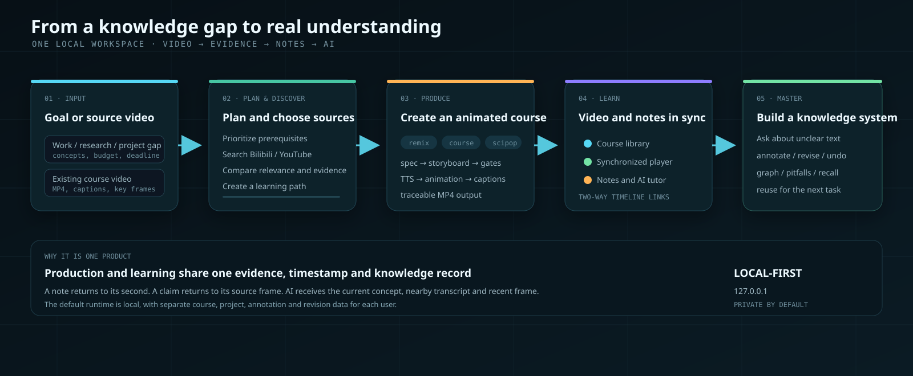
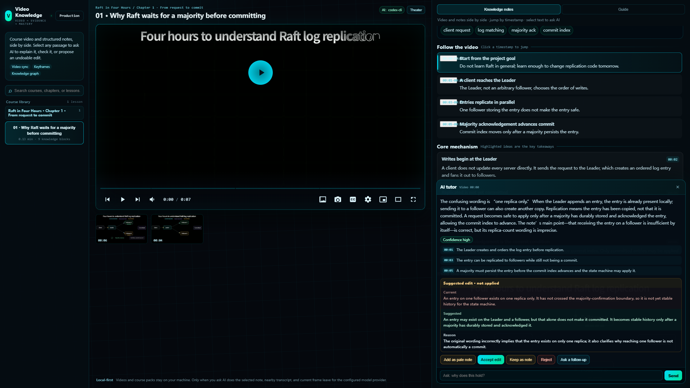
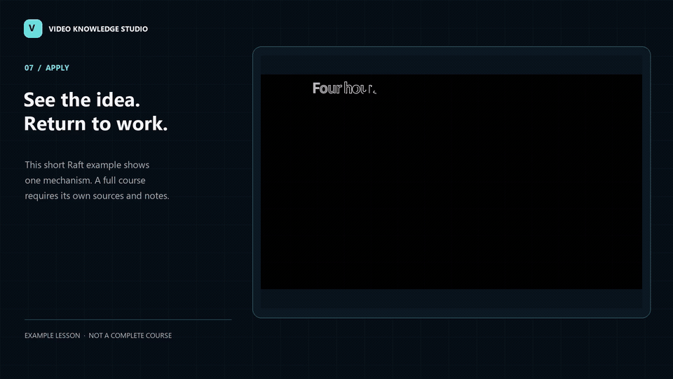

# Video Knowledge Studio

### From a learning goal to a course you can actually use

Need to understand an unfamiliar codebase, reproduce a paper, or prepare for a new
role? Bring your goal and available time. With an Agent (an assistant that can use
tools for multi-step tasks), select sources and
build a learning path; then use the workspace to study videos alongside notes and
ask questions tied to the relevant moment.

**For people and Agents:** find Bilibili or YouTube learning sources with external
search tools, organize multiple sources into an animation plan, render a lesson,
and study timestamped notes with contextual questions. [Chinese quick start](docs/quickstart-zh.md)
· [Agent MCP tools](docs/agent-mcp.md) · [Capability boundaries](#what-works-today)

[](https://github.com/dan-jun/video-knowledge-studio/actions/workflows/ci.yml)
[](CHANGELOG.md)
[](LICENSE)
[](https://github.com/dan-jun/video-knowledge-studio/pkgs/container/video-knowledge-studio)

[Watch the English demo](https://github.com/dan-jun/video-knowledge-studio/releases/download/v0.2.8/video-knowledge-studio-product-demo-en-motion.mp4?download=1) · [Why this is different](#why-another-video-tool-is-not-enough) · [Demand-driven learning](#demand-driven-learning) · [Learning workspace](#learning-workspace) · [Video production](#video-production) · [Quick start](#quick-start)

> **Local-first:** course packs, production projects, annotations, and revision
> history stay on your machine unless you explicitly send a question to a model.

[](https://github.com/dan-jun/video-knowledge-studio/releases/download/v0.2.8/video-knowledge-studio-product-demo-en-motion.mp4?download=1)

<sub>The English demo follows a realistic Raft task through assisted planning, a
learning workspace, contextual AI, a knowledge map, production modes, and an example
lesson. Animated diagrams alternate with real product footage; waiting states are cut
out and interface details use stable screenshots.</sub>



## Key terms first

These terms are used throughout the README. Read this table first; every later example
assumes the plain-language meaning shown here.

| Term | Plain-language meaning | Example | First occurrence | Self-assessment |
| --- | --- | --- | --- | --- |
| Agent | An assistant that can carry out a multi-step task using available tools | Find sources and propose a study plan | Introduction | Know / Unsure / Need work |
| Raft | An algorithm that helps servers agree on an ordered history of changes | A leader replicates a request to other servers | This table | Know / Unsure / Need work |
| Knowledge gap | A specific thing you must understand to complete real work | "I need to understand Raft log replication before editing this service." | This table | Know / Unsure / Need work |
| Course pack | A folder containing course metadata, video, and knowledge notes | `packs/raft-demo-en/` | This table | Know / Unsure / Need work |
| Source | The original video, paper, or document used as evidence | One Bilibili lecture about Raft | This table | Know / Unsure / Need work |
| Timestamp | The point in a video where a claim or explanation appears | `00:05-00:07` | This table | Know / Unsure / Need work |
| Knowledge graph | Notes connected by directed prerequisite or causal links | `Leader → Majority ack → Commit` | This table | Know / Unsure / Need work |
| Production mode | The rule set used to create a lesson | `remix`, `course`, or `scipop` | This table | Know / Unsure / Need work |
| Spec | The editable source file that defines narration and visuals per page | `demo-math.json` | This table | Know / Unsure / Need work |
| Gate | An automated delivery check that can block an unfinished or unsupported video | Source, citation, practice, and playback checks | This table | Know / Unsure / Need work |
| AI tutor | A model request supplied with the selected note, nearby transcript, and current frame | "Why does this boundary hold?" | This table | Know / Unsure / Need work |
| Local-first | The default architecture keeps private course data on the user's computer | The app listens on `127.0.0.1` | This table | Know / Unsure / Need work |
| FFmpeg / ffprobe | Tools for working with video and reading its metadata | Extract a frame / read a video's duration | Quick start / Import your own course | Know / Unsure / Need work |
| yt-dlp | An optional tool for retrieving video-site metadata | Find video titles and links | What works today | Know / Unsure / Need work |

## What works today

| Task | Current status |
| --- | --- |
| Play local courses, timed notes and contextual AI questions | Built into the app; a configured model is required for real AI answers |
| Rebuild one lesson into an evidence-linked deep knowledge note | Built into the player; validates complete transcript accounting, a decision for every visual cluster, a connected core-anchor graph and an unlimited deterministic knowledge-atom layer derived from every covered key point |
| Generate every lesson and a course-wide knowledge graph | Provided as resumable batch scripts; each note must pass the per-lesson evidence gate before the course graph can be built |
| Generate, check and render from a reviewed production spec | Built in; the persistent workflow pauses between stages for review |
| Search Bilibili / YouTube | Optional Agent tool using `yt-dlp`; platform access can fail and results need review |
| Select sources and author a sourced spec | Requires an Agent or a person |
| Import videos into a course pack | Creates placeholder notes; transcripts and evidence still need preparation |
| Input a topic and automatically produce a verified course and notes | Not implemented |

The [MCP bridge](docs/agent-mcp.md) exposes existing course, question, production and
workflow operations and optional metadata search; it does not download or verify sources.

## Why another video tool is not enough

> **Core difference:** planning, source discovery, production, learning, and AI
> questions share the same timestamps and knowledge record.


| Common option | Limitation | Video Knowledge Studio |
| --- | --- | --- |
| Video player | Watching, notes, and source evidence live in separate tools | Video, timestamps, and knowledge blocks stay synchronized |
| AI summarizer | The answer often loses the exact source context | Questions include the current second, nearby transcript, and frame |
| General AI chat | Proposed note edits are difficult to review or undo | Edits appear as a diff and require explicit acceptance |
| Video generator | The finished video still needs a separate learning workflow | Generated videos, notes, and evidence return to one workspace |

The result is a closed loop:

```text
learning goal → planning and source selection → animated course
             → knowledge notes → grounded questions
             → reviewable revisions → a stronger learning system
```

## Three practical uses

| Situation | What you get |
| --- | --- |
| **Fill a work-related gap** | A focused short course for a project, paper, or role change |
| **Study a structured course** | Video, notes, source evidence, a knowledge graph, and an AI tutor together |
| **Remaster existing video** | A single-source remix, a multi-source course, or a compact sci-pop lesson |

Each use follows the same path: define a goal, select sources, build or import a
course, study and ask questions, then apply what you learned. The detailed example
below follows a project task; the same path can lead to a reproducible research
explanation or a focused interview review.

## Demand-driven learning


Suppose you have four hours to understand Raft well enough to read the replication
code in a real project:

1. State the goal, your current knowledge, and the available time.
2. Ask the Agent to separate must-learn concepts from useful context and later topics.
3. Search Bilibili and YouTube for multiple complementary sources.
4. Compare relevance, correctness, evidence quality, and coverage.
5. Produce a learning path with time budgets and practice points.
6. Use `course` for a longer synthesis or `scipop` for focused short lessons.
7. Run the gates, render the animation, and generate synchronized notes.
8. Open the local workspace and ask about the exact sentence you do not understand.

Source search and learning-plan creation in this example are **Agent-assisted**:
the Agent needs suitable search tools and access to the sources. They are not
one-click features built into the app. The supplied Raft pack is a short product
demo, not a complete four-hour course. Evaluate sources and check claims yourself.
Generated videos must be prepared as course packs before they appear in the learning
workspace; importing creates placeholders that need completed notes.

Responsibilities are explicit:

- **Agent:** decomposes the goal, searches sources, compares evidence, and plans the path.
- **Video Knowledge Studio:** produces video, manages knowledge, and provides grounded,
  local context for AI questions.
- **You:** approve the goal and sources, then judge whether important conclusions hold.

<details>
<summary><strong>Example prompt you can give an Agent</strong></summary>

```text
Build a demand-driven learning plan for "distributed consistency: from CAP to Raft."
I understand HTTP and databases but have not studied distributed consensus.
I have four hours and need to understand the Raft log replication code in a real project.
Decompose the concepts, search multiple complementary Bilibili and YouTube sources,
and use Video Knowledge Studio's course mode to create a sourced animated course
with synchronized notes. Keep source and timestamp evidence for every important claim.
Do not invent unavailable sources or evidence.
```

</details>

## Learning workspace



| Area | Purpose |
| --- | --- |
| Course library | Find chapters and lessons, search titles, and inspect duration and knowledge-block counts |
| Video player | Playback, speed, chapters, picture-in-picture, theater mode, screenshots, and fullscreen |
| Knowledge notes | Learning, knowledge and review views; core-anchor graph, complete searchable atom layer, visual evidence, pitfalls, active recall, cross-lesson links, and a local mastery queue |

The timeline is the main connection between reading and watching:

- Playback highlights the current knowledge block.
- Selecting a note timestamp jumps to the corresponding video moment.
- Selecting visual evidence returns to the source frame.
- The deep knowledge plugin separates synthesis from evidence: the raw transcript is
  folded away, while the main surface exposes problems, causal chains, mechanisms,
  examples, boundaries, misconceptions, comparisons, recall and visual proof.
- A deterministic subtitle ledger assigns every second to a teaching, housekeeping or
  uncertainty block; a visual ledger decides every frame while including only clusters
  with unique teaching information; and a typed concept graph connects all central
  concepts without isolated nodes.
- Core anchors stay compact for navigation, while every instructional key point is
  retained as a source-bound knowledge atom. The course view exposes
  course → chapter → lesson → anchor → atom without forcing the default graph to show
  every atom at once.
- The knowledge surface opens in a compact **Learning** view, moves the full anchor and
  atom catalog into **Knowledge**, and reserves **Review** for concepts marked
  “unsure” or “not yet.” Clicking a graph node focuses that anchor, its direct
  neighbours, definitions, mechanisms, evidence and cross-lesson occurrences.
- Reading mode gives the note pane more space than the video and scales primary
  questions, explanations and controls for comfortable reading. The relationship graph
  stays collapsed until requested; selecting a large anchor card opens the focused
  graph instead of forcing users to decode a dense miniature map.
- The **Knowledge Galaxy** renders the complete course as a navigable star map. Every
  canonical concept is a larger light point, every knowledge atom is a smaller note
  star, and typed concept relations are visible beams. Chapters form separate colored
  clusters, while searching or selecting a point reveals its hierarchy, direct
  neighbours, timestamps and cross-lesson occurrences.
- The Galaxy opens as an immersive canvas with live search suggestions, chapter
  navigation, relation-type filters and an optional one-hop neighbourhood view. This
  keeps the graph full-screen instead of forcing learners to scroll past the lesson
  introduction before they can explore it.
- When deep notes are present, legacy summary and timeline cards are suppressed to
  avoid rendering two competing note systems. They remain the fallback for lessons
  without a deep note, and their complete source material is represented in Knowledge.
- Mastery is stored per lesson in the browser's local storage. It does not require an
  account or upload learning state to a server, and the review queue survives a page
  refresh on the same device and browser profile.
- The player distinguishes current semantic review from a structural pass. Review
  sidecars are bound to the note, transcript and frame hashes, so any repair makes an
  older review visibly stale instead of silently reusing its approval.
- When available, the AI tutor receives the selected note, nearby transcript,
  timestamp and a relevant video frame with your question.

### AI edits are reviewable, not silent

An answer first exposes evidence, confidence, and a proposed change. The main text is
not modified until you accept the edit. You can also keep a pale side note, reject the
change, or undo an edit that has already been applied.


<sub>An answer combines an explanation, timestamp evidence, confidence, and an editable diff.</sub>

## Video production


| Mode | Best for | Delivery rules |
| --- | --- | --- |
| `remix` | Remastering one source | Preserve all substantive information; require citations, practice, recap, and animation density |
| `course` | Integrating multiple sources | 15–60 minutes, chapters, at least two sources, practice, and strict citations |
| `scipop` | Explaining one idea clearly | 2–6 minutes, page-specific visual design, high animation density, and a final recap |

```text
spec → storyboard → gates → Edge TTS → animation render
     → captions → playable preview / download
```

The English demo includes this animated Raft log replication scene:



Generated scenes, audio, caches, and final video files live under `data/production/`.
They are excluded from Git and do not overwrite existing courses or annotations.

The production page can run a persistent, reviewable workflow: generate a storyboard,
review it, run checks, review again, and render. A failed or cancelled stage can be
retried. After a server restart interrupts a running process, inspect and stop the old
process tree before confirming it stopped and starting a new workflow. This is a
production workflow from an existing spec, not automatic source-to-course creation.

See [the production-mode guide](docs/video-production.md) for the complete workflow.

## Quick start

### Option 1: Docker

Install Docker Desktop on Windows or macOS, or Docker Engine with Compose on Linux.

```bash
git clone https://github.com/dan-jun/video-knowledge-studio.git
cd video-knowledge-studio
```

Windows:

```powershell
.\docker-up.ps1 -Open
```

macOS / Linux:

```bash
./docker-up.sh
```

The launcher chooses a free port, generates a password, prints the URL and password,
and starts the learning and production environment. It first tries the published
`ghcr.io/dan-jun/video-knowledge-studio:latest` image and falls back to a local build.
Open the printed URL and sign in with the printed password. The default Docker
configuration uses the offline demo AI; see [Docker AI setup](docs/docker.md#ai-inside-the-container)
to configure a model.

To test source changes with a local image:

```powershell
.\docker-up.ps1 -Open -BuildFromSource
```

### Option 2: Agent and Plugin

Install directly from the public GitHub marketplace without keeping a local checkout:

```bash
codex plugin marketplace add dan-jun/video-knowledge-studio
codex plugin add video-knowledge-studio@video-knowledge-studio-local
```

This is repository-backed distribution. It does not require publication in the
universal Plugins Directory.

For the full local application and installer workflow:

```bash
git clone https://github.com/dan-jun/video-knowledge-studio.git
cd video-knowledge-studio
```

Windows:

```powershell
.\install.ps1
```

macOS / Linux:

```bash
./install.sh
```

The installer registers the local Plugin marketplace and exposes:

```text
$video-knowledge-studio
$demand-driven-video-learning
```

To install only the Agent capabilities without launching the app:

```powershell
.\install-agent.ps1
```

Reopen Codex or create a new chat after installation. See
[Agent Skill and Plugin](docs/plugin.md) for details.

### Option 3: Local Python

The learning workspace needs Python 3.10 or newer:

```powershell
python -m vks
```

Run this from the cloned repository, then open `http://127.0.0.1:7870/` unless
you configured a different address or port. The bundled demo is available on startup.
Install FFmpeg separately for frame extraction.

Video production also needs the production dependencies:

```powershell
python -m pip install -e ".[production]"
python -m vks
```

Automatic transcription of source video is optional:

```powershell
python -m pip install -e ".[transcription]"
```

## Enable AI

Local Python defaults to `auto`: it tries the Codex CLI, then a configured
OpenAI-compatible provider, then offline demo mode. The response identifies the
provider actually used; check it if a request falls back. Offline demo mode tests the
interface and synchronization but does not generate trusted knowledge claims.
Docker defaults to offline demo mode and cannot use the host's Codex CLI directly.
Configure Docker separately as described in [Docker AI setup](docs/docker.md#ai-inside-the-container).

Local Codex:

```powershell
$env:VKS_AI_PROVIDER="codex"
python -m vks
```

OpenAI-compatible endpoint:

```powershell
$env:VKS_AI_PROVIDER="openai"
$env:OPENAI_BASE_URL="https://api.openai.com/v1"
$env:OPENAI_API_KEY="..."
$env:VKS_MODEL="gpt-4.1-mini"
python -m vks
```

For a complete course, generate validated notes with a resumable batch:

```powershell
python scripts/generate_course_deep_notes.py --course demo --workers 2
python scripts/semantic_review_deep_notes.py --course demo --workers 2
python scripts/build_course_graph.py --course demo
```

Completed episodes are skipped on later runs. Failed episodes retain their errors in
`data/cache/deep_notes/batch-state.json` and can be retried without regenerating the
rest of the course. Semantic reviews are stored under
`data/cache/deep_notes/reviews/`; editing a note invalidates its previous review.

## Import your own course

```text
packs/my-course/
├─ course.json
├─ media/
│  ├─ lesson-01.mp4
│  └─ lesson-02.mp4
└─ knowledge/
   ├─ e01.json
   └─ e02.json
```

For a local Python installation, create a starter structure in your existing video
directory (the importer writes files there and leaves the videos in place):

```powershell
python scripts/import_course.py --input "D:\courses\my-course" --title "My course"
$env:VKS_PACKS="D:\courses\my-course"
python -m vks
```

Install `ffprobe` on PATH before importing to record durations; otherwise they are
stored as zero. The importer creates placeholder notes, not verified teaching
content. Complete them from transcripts and visual evidence before relying on them.
If `course.json` already exists, importing stops unless `--force` is supplied;
`--force` rewrites the manifest and generated note files. For Docker, put the pack
under the mounted `packs/` directory, or adjust the mount; a host-only `VKS_PACKS`
path is not automatically visible inside the container.
See [course-pack format](docs/course-pack.md) and the
[`raft-demo-en`](packs/raft-demo-en) example.

## Privacy and boundaries

- The app listens on `127.0.0.1` by default.
- Every user owns a separate local instance and local data.
- Courses, production projects, and annotations are excluded from Git by default.
- When you invoke the tutor, its request includes selected text, lesson details,
  recent conversation, timestamp, question, and any available nearby transcript and
  frame. A configured model provider receives that context; offline demo mode stays local.
- This is not a multi-tenant SaaS product with account isolation.
- AI output still needs human judgment. Important claims should retain evidence,
  source context, and uncertainty.
- External videos, captions, screenshots, and handouts must be licensed independently.

See [limitations](docs/limitations.md) and [deployment](docs/deployment.md) for the
trust boundary and supported environments.

## Development and verification

```powershell
python -m pip install -e ".[dev]"
python -m unittest discover -s tests -v
node --check web/app.js
node --check web/knowledge.js
node --check web/production.js
node --check web/i18n.js
```

CI builds the Docker image, starts the container, signs in, and verifies the production
page and dependencies.

## Documentation

| Topic | Document |
| --- | --- |
| Full feature inventory | [Features](docs/features.md) |
| Agent Skill and Plugin | [Plugin bundle](docs/plugin.md) |
| Demand-driven learning and production rules | [Production modes](docs/video-production.md) |
| Course data format | [Course packs](docs/course-pack.md) |
| Docker | [One-command setup](docs/docker.md) |
| HTTP API | [API](docs/api.md) |
| AI providers and configuration | [Configuration](docs/configuration.md) |
| Architecture and trust boundaries | [Architecture](docs/architecture.md) |
| Deployment and limits | [Deployment](docs/deployment.md) · [Limitations](docs/limitations.md) |
| Launch assets | [Launch kit](docs/launch-kit.md) |

<details>
<summary><strong>Roadmap (not implemented yet)</strong></summary>

- Automatic learning plans, time budgets, and prerequisite graphs
- In-app Bilibili / YouTube search, caption collection, and source scoring
- Automatic production-mode selection and initial spec generation
- Persistent production workflow recovery without manual process inspection after a server restart
- Anki, spaced repetition, and learning analytics
- Streaming AI answers
- SRT, PDF, and Obsidian export
- Multi-user sharing and paragraph-level comments

</details>

## Contributing

Read [CONTRIBUTING.md](CONTRIBUTING.md) and [SECURITY.md](SECURITY.md). Bug reports and
feature proposals are most useful with a minimal course pack, reproduction steps, and
the expected behavior.

## License

The code and repository demo content use the [MIT License](LICENSE). External course
packs do not inherit this repository's license automatically.
