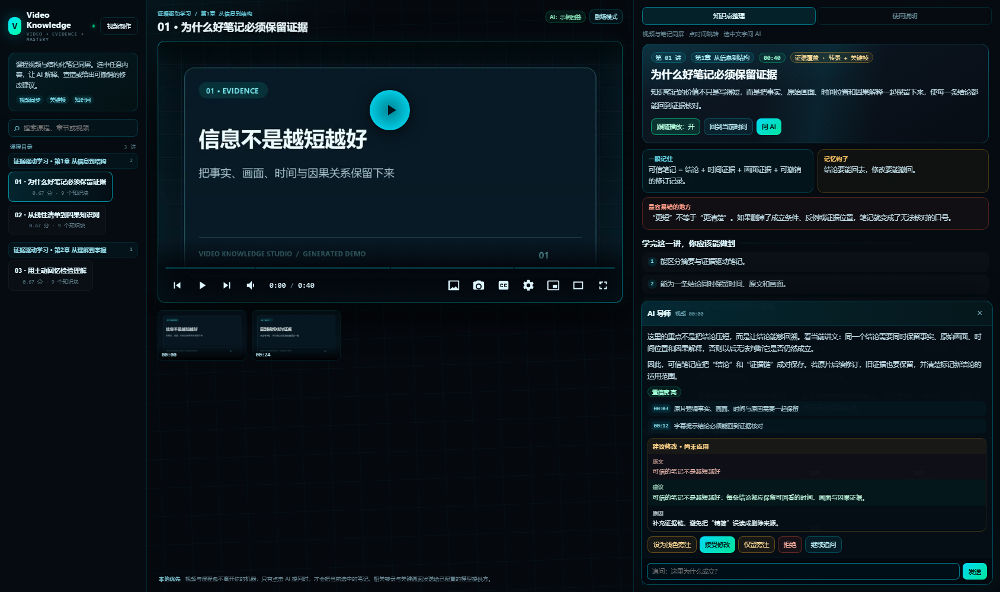
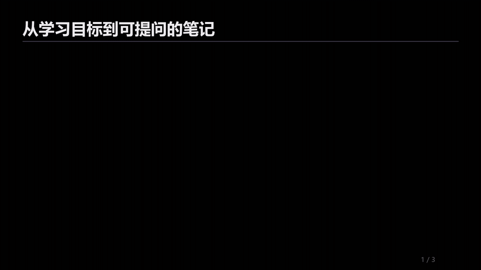

# Video Knowledge Studio

### 从一个知识缺口，到一套真正学得会的课程

输入一个工作、科研或项目中的学习目标。Agent 帮你拆解知识点、搜索 B 站和 YouTube
上的多个互补来源；工作台把内容整合成动画课程和结构化笔记。看不懂的地方，直接在
右侧选中文字追问 AI。

[](https://github.com/dan-jun/video-knowledge-studio/actions/workflows/ci.yml)
[](CHANGELOG.md)
[](LICENSE)

[核心场景](#三种核心用法) · [按需学习](#按需学习怎么做到) · [快速开始](#快速开始) · [文档](#文档)

> 本地优先：课程、制作项目、批注和修订默认只保存在自己的电脑上。


<details>
<summary><strong>术语速查</strong></summary>

| 术语 | 白话含义 | 自评 |
| --- | --- | --- |
| Agent | 能调用搜索、下载和本地工具的 AI 执行程序 | 会 / 模糊 / 不会 |
| 规格（spec） | 控制每页画面、口播和结构的源文件 | 会 / 模糊 / 不会 |
| 门禁 | 交付前自动执行的质量检查 | 会 / 模糊 / 不会 |
| 课程包 | 存放课程、视频和知识数据的目录 | 会 / 模糊 / 不会 |
| 知识网 | 概念之间前后置关系的网络 | 会 / 模糊 / 不会 |

</details>

## 三种核心用法

| 场景 | 你会得到什么 |
| --- | --- |
| **临时补一块知识** | 告诉 Agent 目标、基础和时间，规划来源并制作成一门短课或系列短片 |
| **系统学习一门课** | 视频、时间戳、关键画面、知识笔记和 AI 导师在同一屏内协作 |
| **重做已有视频** | 用 `remix`、`course` 或 `scipop` 重新组织讲解并渲染新成片 |

不需要把三个场景分开使用：制作出的课程可以立即进入学习工作台，学习中的批注和
修订也会继续保存在本地。


## 按需学习怎么做到


职责很清晰：

- **Agent**：拆目标、查资料、比较来源、编排学习路径。
- **Video Knowledge Studio**：整合内容、生成视频、整理笔记、提供 AI 追问。
- **你**：确认目标和来源，检查重要结论。

<details>
<summary><strong>展开：可直接交给 Agent 的示例</strong></summary>

```text
为“分布式一致性：从 CAP 到 Raft”制定一份按需学习计划。
我的基础是了解 HTTP 和数据库，没系统学过分布式共识；
可用时间是 4 小时，目标是能读懂项目里的 Raft 日志复制代码。
请拆解知识点和优先级，搜索 B 站与 YouTube 的多个互补来源，
使用 Video Knowledge Studio 的 course 模式整合成课程和笔记。
保留每个结论的来源和时间戳，不要使用无法确认的内容。
```

</details>

## 学习工作台


三个分区由播放时间连接：

- **左侧**：课程、章节和视频目录。
- **中间**：同步播放器、章节、倍速、截图和关键帧。
- **右侧**：知识点、术语、画面证据、知识网和 AI 导师。

播放视频会高亮对应笔记；点击笔记时间戳会跳回视频。AI 请求只携带当前问题所需
的选中文字、时间、附近讲稿和一张最相关画面。



<sub>示例回答：解释、时间证据、置信度和可撤销的修改建议同时出现。</sub>

## 视频制作


| 模式 | 用途 |
| --- | --- |
| `remix` 视频涅槃 | 单源重制，压缩冗余但不减少有效知识 |
| `course` 长教学 | 多来源整合成 15–60 分钟的分章课程 |
| `scipop` 科普短片 | 2–6 分钟，高密度、通俗、适合单点学习 |

制作流程：

```text
规格 → 分镜 → 门禁 → TTS → 动画渲染 → 字幕 → MP4
```

下面是真实生成的成片片段：



详细规则见 [视频制作三产线](docs/video-production.md)。

## 快速开始

### Docker：一次启动完整环境

```bash
git clone https://github.com/dan-jun/video-knowledge-studio.git
cd video-knowledge-studio
```

Windows：

```powershell
.\docker-up.ps1 -Open
```

macOS / Linux：

```bash
./docker-up.sh
```

会启动完整学习与制作环境，并顺手安装 Agent Skill/Plugin。

### Agent + Plugin：给 Codex 使用

```powershell
.\install.ps1
```

```bash
./install.sh
```

安装后重新打开 Codex 或新建对话。随后可以直接使用：

```text
$video-knowledge-studio
$demand-driven-video-learning
```

只安装 Agent 能力、不启动应用：

```powershell
.\install-agent.ps1
```

### 本机 Python

```powershell
python -m vks
```

视频制作需要：

```powershell
python -m pip install -e ".[production]"
python -m vks
```

## AI 配置

默认离线模式只验证界面，不生成可信知识结论。

使用 Codex：

```powershell
$env:VKS_AI_PROVIDER="codex"
python -m vks
```

使用 OpenAI-compatible 接口：

```powershell
$env:VKS_AI_PROVIDER="openai"
$env:OPENAI_BASE_URL="https://api.openai.com/v1"
$env:OPENAI_API_KEY="..."
$env:VKS_MODEL="gpt-4.1-mini"
python -m vks
```

## 隐私与边界

- 每个人在自己的电脑上拥有独立实例，默认地址仅本机可访问。
- 这是单用户本地工作台，不是带账号隔离的多租户 SaaS。
- 外部课程视频、字幕和图片必须确认授权。
- AI 回答和修订建议仍需人工判断。

## 文档

| 想了解 | 文档 |
| --- | --- |
| 全部功能 | [功能清单](docs/features.md) |
| Agent Skill 与 Plugin | [能力包](docs/plugin.md) |
| 按需学习与生产规则 | [三产线](docs/video-production.md) |
| 课程包格式 | [course-pack](docs/course-pack.md) |
| Docker | [docker](docs/docker.md) |
| API | [api](docs/api.md) |
| 配置 | [configuration](docs/configuration.md) |
| 部署与限制 | [deployment](docs/deployment.md) · [limitations](docs/limitations.md) |

## 开发

```powershell
python -m pip install -e ".[dev]"
python -m unittest discover -s tests -v
node --check web/app.js
node --check web/knowledge.js
node --check web/production.js
```

<details>
<summary><strong>Roadmap（尚未实现）</strong></summary>

- 自动学习计划、时间预算和知识依赖图
- 内置 B 站/YouTube 搜索、字幕采集和来源评分
- 自动选择制作模式并生成初版规格
- Anki、间隔重复和学习统计
- SRT、PDF、Obsidian 导出
- 多人分享与逐段评论

</details>

## Contributing

请阅读 [CONTRIBUTING.md](CONTRIBUTING.md) 和 [SECURITY.md](SECURITY.md) 后提交最小复现。

## License

代码和仓库内演示内容使用 [MIT License](LICENSE)。外部课程包不自动继承本仓库许可证。
