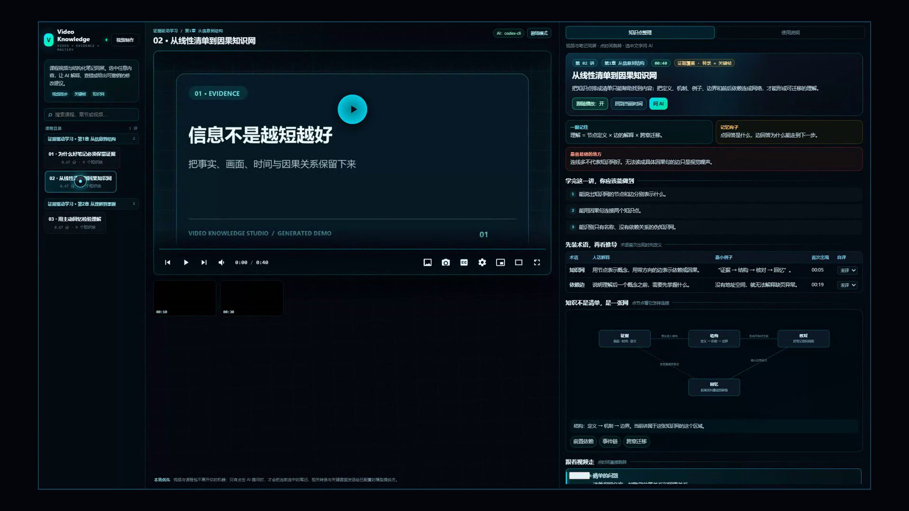
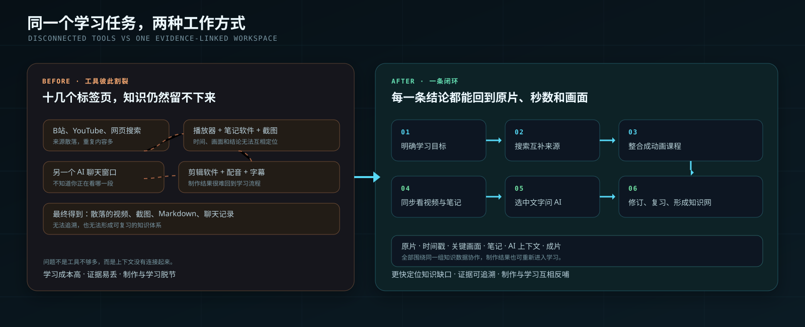
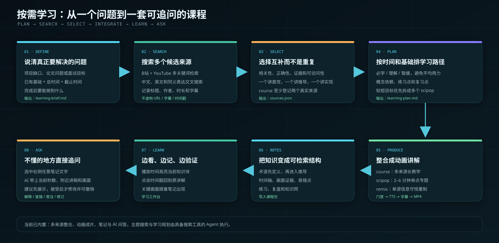
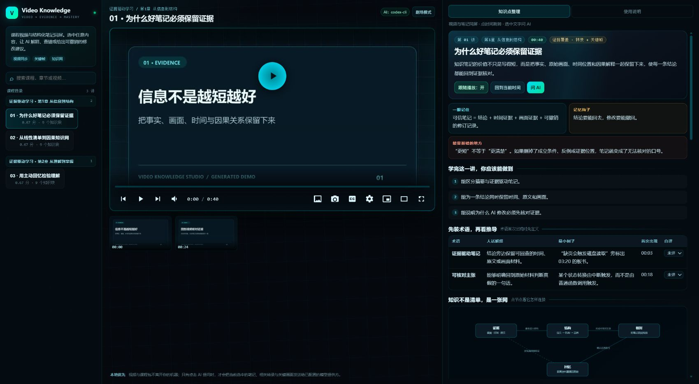
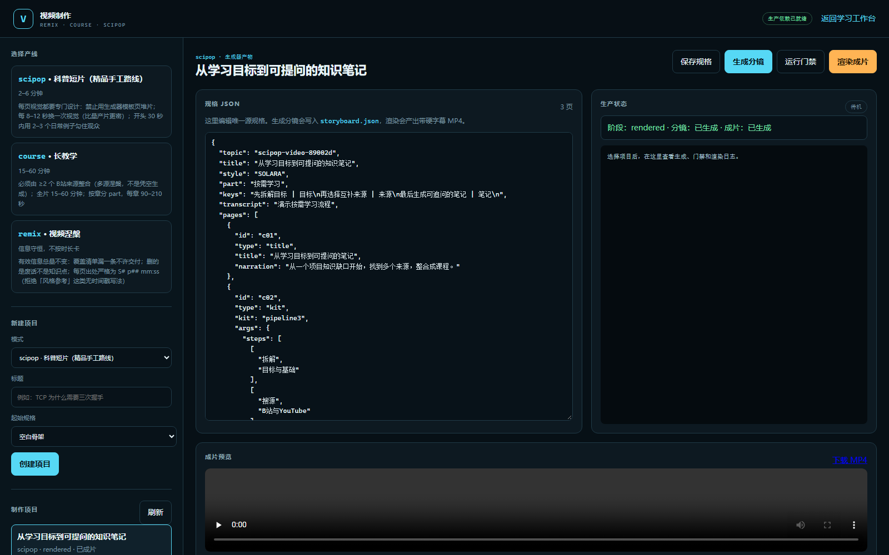

# Video Knowledge Studio

### 从一个知识缺口，到一套真正学得会的课程

输入一个工作、科研或项目中的学习目标。Agent 帮你拆解知识点、搜索 B 站和 YouTube
上的多个互补来源；工作台把内容整合成动画课程和结构化笔记。看不懂的地方，直接在
右侧选中文字追问 AI。

[](https://github.com/dan-jun/video-knowledge-studio/actions/workflows/ci.yml)
[](CHANGELOG.md)
[](LICENSE)
[](https://github.com/dan-jun/video-knowledge-studio/pkgs/container/video-knowledge-studio)

[观看 92 秒演示](https://github.com/dan-jun/video-knowledge-studio/releases/download/v0.2.2/video-knowledge-studio-product-demo-92s.mp4) · [核心差异](#为什么不是又一个视频工具) · [按需学习](#按需学习) · [学习工作台](#学习工作台) · [视频制作](#视频制作) · [快速开始](#快速开始)

> **本地优先**：课程、制作项目、批注和修订默认只保存在自己的电脑上。

[](https://github.com/dan-jun/video-knowledge-studio/releases/download/v0.2.2/video-knowledge-studio-product-demo-92s.mp4)

<sub>92 秒发布片：动画解释与真实产品操作连续剪辑，展示学习链、知识网、上下文 AI、三种视频产线和门禁检查。</sub>


<details>
<summary><strong>术语速查</strong></summary>

| 术语 | 白话含义 | 例子 | 自评 |
| --- | --- | --- | --- |
| Agent | 能调用搜索、下载和本地工具的 AI 执行程序 | 查找多个讲解来源并调用制作流程 | 会 / 模糊 / 不会 |
| 课程包 | 存放课程目录、视频和知识数据的目录 | `packs/my-course/` | 会 / 模糊 / 不会 |
| 规格（spec） | 控制每页画面、口播和结构的源文件 | `demo-math.json` | 会 / 模糊 / 不会 |
| 门禁 | 成片交付前自动执行的质量检查 | 检查来源、练习、覆盖率和视频 | 会 / 模糊 / 不会 |
| 知识网 | 概念之间前后置关系的网络 | “函数 → 导数 → 优化” | 会 / 模糊 / 不会 |

</details>

## 为什么不是又一个视频工具

> **核心差异：规划、找资料、制作、学习和 AI 追问共享同一份时间戳与知识数据。**



| 常见方案 | 局限 | Video Knowledge Studio |
| --- | --- | --- |
| 视频播放器 | 只能看，笔记和原片相互割裂 | 视频、时间戳和知识块双向同步 |
| AI 总结工具 | 容易脱离原片，不知道你在看哪一段 | 追问时附带当前秒数、附近讲稿和关键画面 |
| 普通 AI 聊天 | 修改笔记无法审阅、追踪或撤销 | 修改先显示 diff，由你接受、旁注或拒绝 |
| 视频生成器 | 做完成片后还要另找学习工具 | 成片、知识数据和笔记进入同一个工作台 |

它最终形成的是一条闭环：

```text
学习目标 → 规划与选源 → 动画课程 → 知识笔记
        → 边看边问 → 修订与复习 → 新的学习资料
```

## 三种核心用法

| 场景 | 你会得到什么 |
| --- | --- |
| **按需补知识** | 为工作、科研、面试或项目缺口快速组织一门短课 |
| **系统学课程** | 视频、笔记、画面证据、知识网和 AI 导师同屏学习 |
| **重做已有视频** | 单源重制、多源整合或制作高密度科普短片 |

三者不是独立功能：制作出的视频可以直接进入学习工作台；学习过程中产生的新笔记
也可以继续用于下一轮制作。

## 按需学习



例如你只有四小时，需要理解 Raft 才能阅读项目代码：

1. 说清目标、基础和可投入时间。
2. Agent 拆出必学、理解和暂缓内容。
3. 到 B 站和 YouTube 搜索多个互补来源。
4. 比较相关性、正确性、证据和覆盖范围。
5. 生成学习路径、时间分配和练习点。
6. 用 `course` 整合成长教学，或用 `scipop` 拆分多个短专题。
7. 运行门禁、生成动画和笔记。
8. 打开学习工作台，在右侧针对不懂的句子直接追问。

职责划分：

- **Agent**：拆目标、查资料、比较来源、编排路径。
- **Video Knowledge Studio**：制作视频、管理知识、提供本地上下文和 AI 追问。
- **你**：确认目标和来源，判断重要结论是否可靠。

<details>
<summary><strong>展开：可直接交给 Agent 的示例</strong></summary>

```text
为“分布式一致性：从 CAP 到 Raft”制定一份按需学习计划。
我的基础是了解 HTTP 和数据库，但没系统学过分布式共识；
可用时间是 4 小时，目标是能读懂项目里的 Raft 日志复制代码。
请拆解知识点和优先级，搜索 B 站与 YouTube 的多个互补来源，
使用 Video Knowledge Studio 的 course 模式整合成课程和笔记。
保留每个结论的来源和时间戳，不要使用无法确认的内容。
```

</details>

## 学习工作台



| 分区 | 核心功能 |
| --- | --- |
| 左侧课程目录 | 按课程和章节找视频；搜索；查看时长与知识块数量 |
| 中间播放器 | 播放、倍速、章节、画中画、全屏、剧场模式和截图 |
| 右侧知识区 | 术语、机制、画面证据、易错点、主动回忆和知识网 |

最关键的是时间轴：

- 视频播放会高亮当前知识块。
- 点击笔记时间戳会跳回对应视频。
- 点击关键画面也会回到原片位置。
- AI 只读取当前问题所需的选中文字、时间和附近上下文。

### 不是“让 AI 随便改笔记”

AI 的回答会先显示证据、置信度和建议修改。只有你确认后才会写入正文；也可以只留
浅色旁注，已接受的修改还能撤销。


<sub>示例回答：解释、时间证据、置信度和修改 diff 同时出现。</sub>

## 视频制作



| 模式 | 适合什么 | 质量标准 |
| --- | --- | --- |
| `remix` 视频涅槃 | 单源重制 | 信息守恒、出处、练习、复盘、动画密度 |
| `course` 长教学 | 多来源整合 | 15–60 分钟、分章、多源、练习与严格出处 |
| `scipop` 科普短片 | 单点概念 | 2–6 分钟、逐页设计、高视觉密度、片尾复盘 |

```text
规格 → 分镜 → 门禁 → Edge TTS → 动画渲染
     → 字幕 → 成片预览 / 下载
```

下面的片段由项目真实生成和渲染：


生成场景、音频、缓存和成片都在 `data/production/`，不会自动进入 Git，也不会覆盖
已有课程与批注。

详细规则见 [视频制作三产线](docs/video-production.md)。

## 快速开始

### 方式一：Docker（完整环境）

先安装 Docker Desktop（Windows/macOS）或 Docker Engine + Compose（Linux）。

```bash
git clone https://github.com/dan-jun/video-knowledge-studio.git
cd video-knowledge-studio
```

Windows：

```powershell
.\docker-up.ps1 -Open
```

macOS / Linux：

```bash
./docker-up.sh
```

脚本会自动选端口、生成密码，并安装完整学习与制作依赖。Docker 启动时也会顺手
安装随仓库分发的 Agent Skill/Plugin。启动器会优先拉取
`ghcr.io/dan-jun/video-knowledge-studio:latest`，拉取失败时才回退到本地构建。

修改源码后需要构建本地版本：

```powershell
.\docker-up.ps1 -Open -BuildFromSource
```

### 方式二：Agent + Plugin

```bash
git clone https://github.com/dan-jun/video-knowledge-studio.git
cd video-knowledge-studio
```

Windows：

```powershell
.\install.ps1
```

macOS / Linux：

```bash
./install.sh
```

安装后会注册本地 Plugin marketplace，并安装：

```text
$video-knowledge-studio
$demand-driven-video-learning
```

只安装 Agent 能力、不启动应用：

```powershell
.\install-agent.ps1
```

重新打开 Codex 或新建对话后生效。详细说明见 [Agent Skill 与 Plugin](docs/plugin.md)。

### 方式三：本机 Python

运行学习工作台只需要 Python 3.10+：

```powershell
python -m vks
```

视频制作需要：

```powershell
python -m pip install -e ".[production]"
python -m vks
```

自动转录源视频还需要可选组件：

```powershell
python -m pip install -e ".[transcription]"
```

## 启用 AI

未配置模型时是离线演示模式，只验证界面，不产生可信知识结论。

本机 Codex：

```powershell
$env:VKS_AI_PROVIDER="codex"
python -m vks
```

OpenAI-compatible：

```powershell
$env:VKS_AI_PROVIDER="openai"
$env:OPENAI_BASE_URL="https://api.openai.com/v1"
$env:OPENAI_API_KEY="..."
$env:VKS_MODEL="gpt-4.1-mini"
python -m vks
```

## 导入自己的课程

```text
packs/my-course/
├─ course.json
├─ media/
│  ├─ lesson-01.mp4
│  └─ lesson-02.mp4
└─ knowledge/
   ├─ e01.json
   └─ e02.json
```

从视频目录生成起步结构：

```powershell
python scripts/import_course.py --input "D:\courses\my-course" --title "我的课程"
```

导入器只生成结构和真实时长，不会虚构笔记。详见
[课程包格式](docs/course-pack.md) 和 [`packs/demo`](packs/demo)。

## 隐私与边界

- 默认只监听 `127.0.0.1`，每个人拥有自己的实例和本地数据。
- 课程、制作项目和批注默认被 Git 忽略。
- 只有主动提问时，才向模型发送当前问题所需的局部上下文。
- 这不是带账号隔离的多租户 SaaS。
- AI 结果仍需人工判断；重要结论应保留出处、画面和不确定性。
- 外部视频、字幕、截图和讲义必须分别确认授权。

完整边界见 [当前限制](docs/limitations.md) 和 [部署模式](docs/deployment.md)。

## 开发与验证

```powershell
python -m pip install -e ".[dev]"
python -m unittest discover -s tests -v
node --check web/app.js
node --check web/knowledge.js
node --check web/production.js
```

CI 会实际构建 Docker 镜像、启动容器、登录、检查制作页和生产依赖。

## 文档

| 想了解 | 文档 |
| --- | --- |
| 全部功能 | [功能清单](docs/features.md) |
| Agent Skill 与 Plugin | [能力包](docs/plugin.md) |
| 按需学习与生产规则 | [三产线](docs/video-production.md) |
| 课程数据格式 | [课程包](docs/course-pack.md) |
| Docker | [一键运行](docs/docker.md) |
| HTTP API | [API](docs/api.md) |
| 配置与 AI | [配置项](docs/configuration.md) |
| 架构与信任边界 | [架构](docs/architecture.md) |
| 部署与限制 | [部署](docs/deployment.md) · [限制](docs/limitations.md) |
| 发布与推广素材 | [Launch kit](docs/launch-kit.md) |

<details>
<summary><strong>Roadmap（尚未实现）</strong></summary>

- 自动学习计划、时间预算和知识依赖图
- 内置 B 站 / YouTube 搜索、字幕采集和来源评分
- 自动选择制作模式并生成初版规格
- Anki、间隔重复和学习统计
- 流式 AI 回答
- SRT、PDF、Obsidian 导出
- 多人分享与逐段评论

</details>

## Contributing

请阅读 [CONTRIBUTING.md](CONTRIBUTING.md) 和 [SECURITY.md](SECURITY.md)。功能建议最好
附带最小课程包、复现步骤和预期行为。

## License

代码和仓库内演示内容使用 [MIT License](LICENSE)。外部课程包不会自动继承本仓库许可证。
