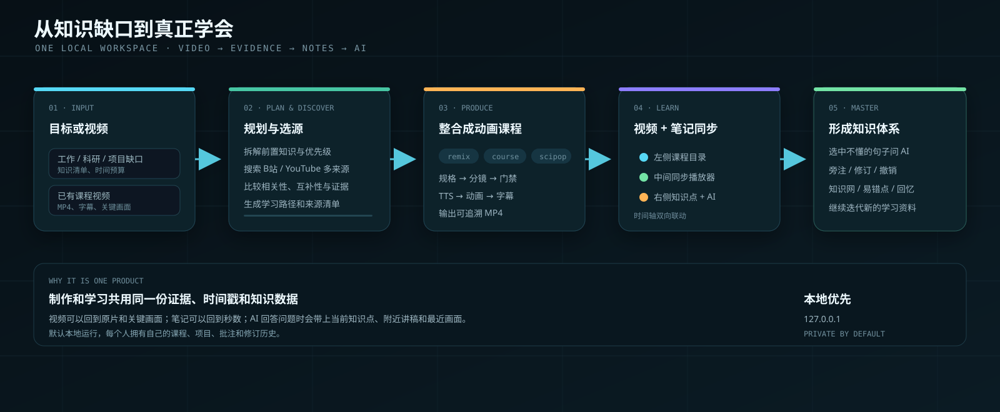

# Video Knowledge Studio

一个本地优先的课程视频学习与再创作工作台。

它把三件事放在同一条链路里：**把视频重制成更好懂的课程、边看视频边整理知识、
让 AI 基于真实画面和讲稿辅助理解**。课程、笔记和制作结果都保存在自己的电脑上。

[](https://github.com/dan-jun/video-knowledge-studio/actions/workflows/ci.yml)
[](CHANGELOG.md)
[](LICENSE)

> 仓库不包含第三方课程视频、字幕或讲义。附带的 MIT 演示内容由本项目生成。

## 先看整体



<sub>制作和学习不是两个割裂的工具：视频、时间戳、知识数据和 AI 上下文在同一条链路里。</sub>

## 产品界面


<sub>学习工作台：左侧课程目录，中间播放器与关键帧，右侧知识点、画面证据与 AI 导师。</sub>

## 先认识几个词

| 术语 | 白话含义 | 例子 | 首次出现 | 自评 |
| --- | --- | --- | --- | --- |
| 学习工作台 | 同时看视频、读知识点、问 AI 的页面 | 左侧选课，中间播放，右侧看笔记 | 本文 | 会 / 模糊 / 不会 |
| 课程包 | 集中存放课程目录、视频和知识数据的文件夹 | `packs/my-course/` | 本文 | 会 / 模糊 / 不会 |
| 视频制作 | 从可编辑规格生成动画、配音和字幕成片的流程 | 输入 `spec.json`，输出 MP4 | 本文 | 会 / 模糊 / 不会 |
| 规格（spec） | 控制每页画面、口播和结构的可编辑源文件 | `demo-math.json` | 本文 | 会 / 模糊 / 不会 |
| 门禁 | 交付前自动执行的质量检查 | 检查出处、练习、覆盖率和成片 | 本文 | 会 / 模糊 / 不会 |
| 知识网 | 把概念和前后置关系连起来的图 | “函数 → 导数 → 优化” | 本文 | 会 / 模糊 / 不会 |
| Agent | 能调用搜索、下载、代码和本地工具的智能执行程序 | 自动查找视频并调用本项目渲染 | 本文 | 会 / 模糊 / 不会 |
| 学习路径 | 按目标、基础和时间安排的先后学习顺序 | 先学一致性模型，再学 Raft | 本文 | 会 / 模糊 / 不会 |

## 结合在一起能完成什么

这个项目不是单独一个播放器，也不是单独一个视频生成器。结合起来可以做到：

- **把分散的视频整理成课程**：按课程、章节和讲次排序，搜索和切换。
- **边看边学**：视频、时间戳和知识块双向同步，不会在视频与笔记之间来回找位置。
- **看懂画面中的关键内容**：知识点可以绑定关键帧、画面解释和易错边界。
- **针对不懂的地方提问**：选中笔记文字后，AI 同时参考当前秒数、附近讲稿和最近画面。
- **安全地修订笔记**：AI 只能先给建议；接受、仅留旁注或拒绝都由学习者决定，修改可撤销。
- **形成体系而不是背清单**：用术语表、前后置关系、知识网和主动回忆检查掌握程度。
- **重制或整合课程**：把单源视频重制、把多来源整合成长课，或制作几分钟科普短片。
- **把制作结果重新拿去学习**：成片和知识数据可以作为新的课程包继续阅读、提问和修订。

### 一个完整例子

假设你有两套课程视频和一份教材：

1. 用 `course` 把多个来源整理成一门带章节、练习和复盘的长课。
2. 用 `remix` 把其中一个难点单独重制成更短的动画讲解。
3. 用 `scipop` 制作一个 3 分钟的科普短片。
4. 把成片、讲稿、术语和关键画面放进课程包。
5. 在学习工作台里边看边整理，针对不懂的段落向 AI 提问。
6. 接受可靠的修订，保留不同意见为旁注，最后用知识网和主动回忆复习。

### 按需学习：为工作、科研或项目快速补一块知识

不一定先有一整套课程。你也可以从**一个学习目标、项目缺口或零散知识点清单**
开始，例如：

- “三天内看懂 Raft，并能判断项目里哪些状态需要持久化。”
- “为论文实验补上 Transformer 注意力的数学基础。”
- “项目要用消息队列，先搞懂投递语义、重试和幂等。”
- “下周面试前快速复习操作系统中的虚拟内存。”

实际工作流是：

1. 先拆解目标：区分必须掌握、需要理解、暂时可以跳过的知识点。
2. 根据基础和时间生成学习路径，不平均用力。
3. 到 B 站和 YouTube 搜索同一知识点的多个讲解来源。
4. 比较来源质量、互补性和覆盖范围，选出 2–4 个候选视频。
5. 提取字幕、关键画面和出处，围绕知识目标重新组织，而不是简单拼接原片。
6. 用 `course` 整合成长教学，或用 `scipop` 只做当前需要的短专题。
7. 运行门禁、生成动画成片，并把术语、机制、画面证据、易错点和练习整理成笔记。
8. 在学习工作台里边看边学；右侧选中不懂的句子，直接结合当前秒数、讲稿和画面问 AI。


<sub>按需学习流程：定义问题 → 搜索 → 选源 → 规划 → 制作 → 笔记 → 学习 → 追问。</sub>

当前版本可以直接完成多来源整合、动画成片、笔记整理和右侧 AI 问答。
**主题搜索、来源筛选和学习路径编排**目前推荐交给 Codex 或其他 Agent 执行，
生产页面里还没有一个勾选后就自动搜遍全网的按钮；这些能力列在 Roadmap 中。

可以直接给 Agent 这样的任务：

```text
为“分布式一致性：从 CAP 到 Raft”制定一份按需学习计划。
我的基础是了解 HTTP 和数据库，但没系统学过分布式共识；
可用时间是 4 小时，目标是能读懂项目里的 Raft 日志复制代码。
请先拆成知识点和优先级，搜索 B 站与 YouTube 上可公开访问的多个讲解视频，
比较来源和覆盖范围，选出互补来源；然后使用这个项目的 course 模式整合成课程，
生成动画、术语表、知识网、练习题和复盘，并把结果加入学习工作台。
保留每个结论的来源和时间戳，不要使用无法确认的内容。
```

## 两个入口

启动后使用同一个本地地址，通过右上角入口切换。

| 入口 | 地址 | 用途 |
| --- | --- | --- |
| 学习工作台 | `/` | 看视频、读知识、查画面、问 AI、修订和复习 |
| 视频制作 | `/production.html` | 建项目、写规格、生成分镜、跑门禁、渲染和下载成片 |


<sub>视频制作页：三种产线、可编辑规格、生产状态、后台日志和成片预览。</sub>

### 学习工作台的三个分区

| 分区 | 你在这里做什么 |
| --- | --- |
| 左侧：课程目录 | 按课程和章节找视频；搜索标题；查看时长和知识块数量 |
| 中间：同步播放器 | 播放、倍速、章节跳转、画中画、全屏、剧场模式、截图 |
| 右侧：知识点与 AI 导师 | 读术语、机制、画面证据、易错点和知识网；选中文字解释、查错或修订 |

播放时间把三个分区连在一起：视频播放会高亮对应知识块，点击笔记时间戳也会跳回
视频。AI 请求只包含当前问题所需的选中文字、时间、附近讲稿和一张最相关画面。

## 三条视频生产线

“涅槃”在这里指把已有讲课视频重新组织成白板手绘风动画讲解片，不是简单裁剪或转码。

| 模式 | 适合什么 | 必须守住的边界 |
| --- | --- | --- |
| `remix` 视频涅槃 | 把一个原片重做得更紧凑、更好懂 | 不丢有效信息；通常不短于原片 55%；出处、练习、复盘和画面密度必须达标 |
| `course` 长教学 | 把两个以上来源整合成一门完整长课 | 15–60 分钟；分章；每 3–5 页练习；继承 `remix` 的全部质量要求 |
| `scipop` 科普短片 | 用 2–6 分钟讲透一个概念 | 逐页设计、视觉密度高；开头用日常例子；片尾复盘 |

制作页的完整流程是：

```text
编辑 spec → 生成 storyboard / Manim 场景 → 运行门禁
        → Edge TTS 配音 → 逐页渲染 → 拼接 → 烧录字幕
        → 预览 / 下载 MP4
```

下面是仓库内真实生成并渲染的 23 秒成片演示，不是静态设计稿：


制作项目保存在 `data/production/`。生成场景、音频、截图和成片不会自动进入 Git，
也不会覆盖原有课程和学习批注。

详细规则见 [视频制作三产线](docs/video-production.md)。

## 快速开始

### 方式一：Agent + Plugin（推荐给 Codex 用户）

```powershell
git clone https://github.com/dan-jun/video-knowledge-studio.git
cd video-knowledge-studio
.\install.ps1
```

macOS/Linux：

```bash
git clone https://github.com/dan-jun/video-knowledge-studio.git
cd video-knowledge-studio
./install.sh
```

安装器会注册仓库内的本地 Plugin marketplace，安装
`video-knowledge-studio` 与 `demand-driven-video-learning` 两个 Skill，并启动工作台。
如果当前 Codex 不支持 Plugin，会自动把两个 Skill 安装到 `~/.agents/skills/`。

只安装 Agent 能力、不启动应用：

```powershell
.\install-agent.ps1
```

安装后重新打开 Codex 或新建对话，让 Plugin 和 Skill 重新载入。完整说明见
[Agent、Skill 与 Plugin](docs/plugin.md)。

### 方式二：Docker（完整环境）

先安装 Docker Desktop（Windows/macOS）或 Docker Engine + Compose（Linux）。

```powershell
git clone https://github.com/dan-jun/video-knowledge-studio.git
cd video-knowledge-studio
.\docker-up.ps1 -Open
```

macOS/Linux：

```bash
git clone https://github.com/dan-jun/video-knowledge-studio.git
cd video-knowledge-studio
./docker-up.sh
```

脚本会自动选择空闲端口、生成登录密码并打开页面。默认镜像已经包含 Python、
FFmpeg、Manim、Edge TTS 和中文字体，因此学习与视频制作可以一起使用，并会顺手
安装 Agent Skill/Plugin。

### 方式三：本机 Python

运行学习工作台只需要 Python 3.10+：

```powershell
python -m vks
```

需要视频制作时：

```powershell
python -m pip install -e ".[production]"
python -m vks
```

系统需要 FFmpeg。自动转录源视频还需要：

```powershell
python -m pip install -e ".[transcription]"
```

### 启用 AI

未配置模型时使用离线演示模式，只适合检查界面，不产生可信知识结论。

使用本机 Codex：

```powershell
$env:VKS_AI_PROVIDER="codex"
python -m vks
```

使用 OpenAI-compatible 接口：

```powershell
$env:VKS_AI_PROVIDER="openai"
$env:OPENAI_BASE_URL="https://api.openai.com/v1"
$env:OPENAI_API_KEY="..."
$env:VKS_MODEL="gpt-4.1-mini"
python -m vks
```

## 加入自己的课程

课程包的最小结构：

```text
packs/my-course/
├─ course.json
├─ media/
│  ├─ lesson-01.mp4
│  └─ lesson-02.mp4
└─ knowledge/
   ├─ e01.json
   └─ e02.json
```

从已有视频目录生成起步结构：

```powershell
python scripts/import_course.py --input "D:\courses\my-course" --title "我的课程"
```

导入器只会生成真实时长和结构，不会虚构笔记。可参考
[课程包格式](docs/course-pack.md) 和 [`packs/demo`](packs/demo)。

## 隐私与边界

- 默认只监听 `127.0.0.1`，每个人在自己的电脑上拥有独立空间。
- 旁注、修订历史和制作结果默认被 Git 忽略。
- 只有主动点击 AI 提问时，才会向模型发送当前问题所需的局部上下文。
- 这不是多租户 SaaS；一个部署密码不能实现不同用户之间的隔离。
- AI 仍可能出错，重要结论应保留出处、关键画面和不确定性。
- 平台代码与外部课程内容必须分别确认授权。

完整边界见 [当前限制](docs/limitations.md) 和 [部署模式](docs/deployment.md)。

## 开发与验证

```powershell
python -m pip install -e ".[dev]"
python -m unittest discover -s tests -v
node --check web/app.js
node --check web/knowledge.js
node --check web/production.js
```

CI 会实际构建 Docker 镜像、启动容器、登录、检查生产依赖并访问制作页。

## 文档导航

| 想了解 | 文档 |
| --- | --- |
| 全部功能 | [功能清单](docs/features.md) |
| 视频制作规则 | [三条产线](docs/video-production.md) |
| 课程数据格式 | [课程包](docs/course-pack.md) |
| 配置与 AI | [配置项](docs/configuration.md) |
| Docker | [一键运行](docs/docker.md) |
| HTTP 接口 | [API](docs/api.md) |
| 架构与信任边界 | [架构](docs/architecture.md) |
| Agent 自动安装 | [安装说明](docs/agent-install.md) |
| Agent Skill 与 Plugin | [能力包说明](docs/plugin.md) |
| 当前限制 | [限制](docs/limitations.md) |

## Roadmap（尚未实现）

以下内容是未来计划，不是当前版本已有功能。普通使用者可以忽略。

- 一键字幕/ASR、关键帧提取和语义审计
- 输入学习目标后自动生成学习计划、时间预算和知识依赖图
- 内置 B 站 / YouTube 主题搜索、字幕采集和来源质量筛选
- 根据目标自动选择 `course`、`remix` 或 `scipop` 并生成初版规格
- Anki 卡片、间隔重复与学习统计
- 流式 AI 回答
- Obsidian / Markdown / PDF 导出
- 课程包签名与内容许可证检查
- 多人只读分享与逐段评论

## 参与贡献

请先阅读 [CONTRIBUTING.md](CONTRIBUTING.md) 和 [SECURITY.md](SECURITY.md)。提交问题时
最好附上最小课程包、复现步骤和预期结果。

## License

代码和仓库内演示内容使用 [MIT License](LICENSE)。外部课程包不会自动继承本仓库许可证。
