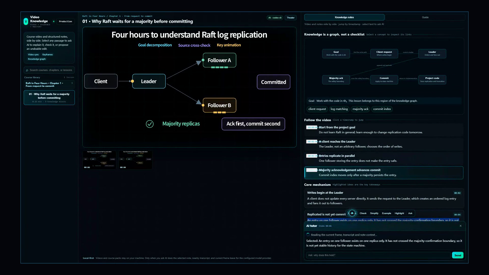
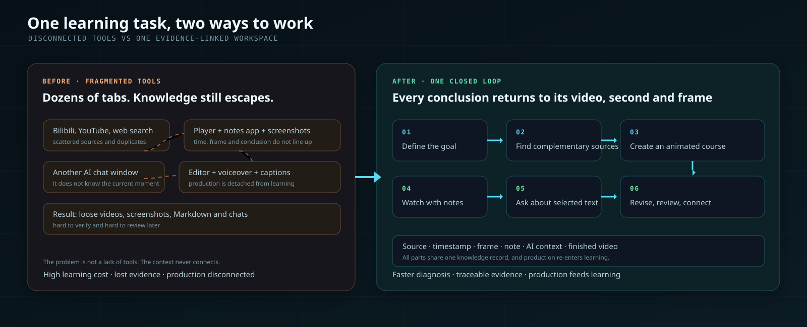
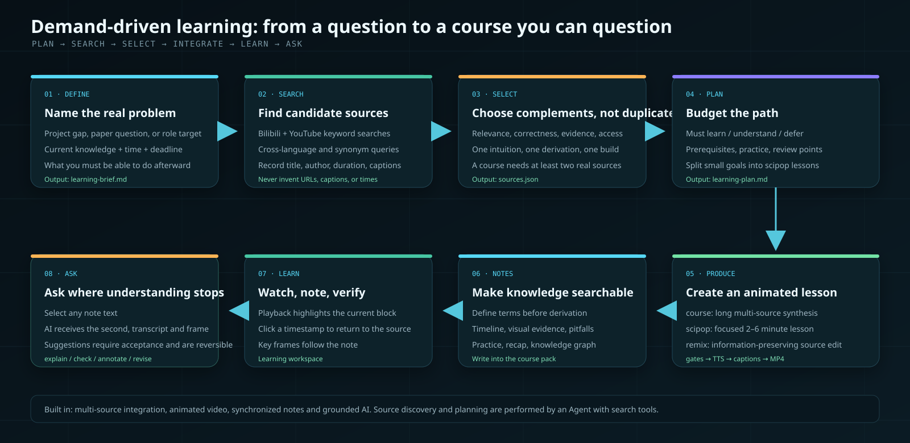
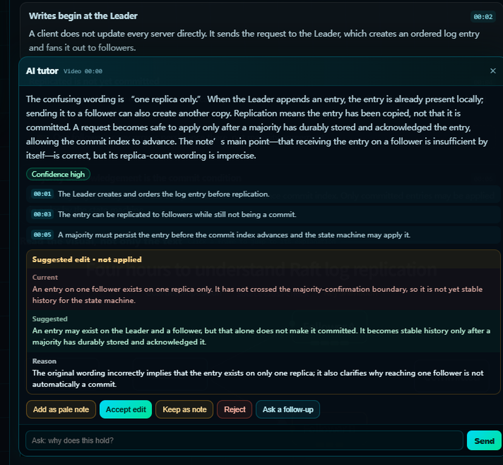
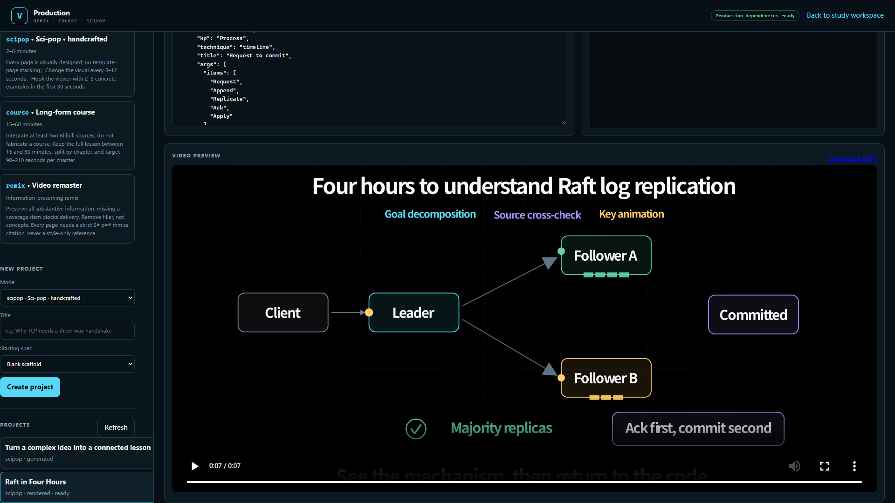
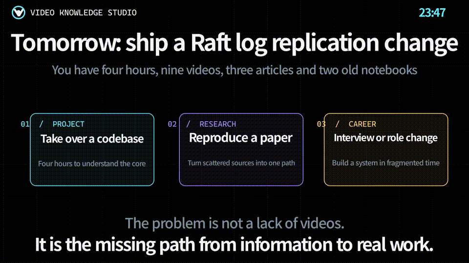

# Video Knowledge Studio

### From a knowledge gap to a course you can actually use

Describe what you need to learn for work, research, or a project. An Agent can break
the goal into concepts, discover complementary Bilibili and YouTube sources, and use
the local production pipeline to turn them into an animated course with structured
notes. When a note is unclear, select it and ask the AI tutor for an explanation,
an evidence check, or a reviewable edit.

[](https://github.com/dan-jun/video-knowledge-studio/actions/workflows/ci.yml)
[](CHANGELOG.md)
[](LICENSE)
[](https://github.com/dan-jun/video-knowledge-studio/pkgs/container/video-knowledge-studio)

[Watch the English demo](https://github.com/dan-jun/video-knowledge-studio/releases/download/v0.2.8/video-knowledge-studio-product-demo-en.mp4?download=1) · [Why this is different](#why-another-video-tool-is-not-enough) · [Demand-driven learning](#demand-driven-learning) · [Learning workspace](#learning-workspace) · [Video production](#video-production) · [Quick start](#quick-start)

> **Local-first:** course packs, production projects, annotations, and revision
> history stay on your machine unless you explicitly send a question to a model.

[](https://github.com/dan-jun/video-knowledge-studio/releases/download/v0.2.8/video-knowledge-studio-product-demo-en.mp4?download=1)

<sub>The English launch film follows a realistic Raft task through source discovery, a
grounded learning workspace, evidence-aware AI, the three production modes, quality
gates, and a generated lesson. Waiting states are cut out, and enlarged interface
details use stable screenshots rather than moving zooms.</sub>


## Key terms first

These terms are used throughout the README. Read this table first; every later example
assumes the plain-language meaning shown here.

| Term | Plain-language meaning | Example | First occurrence | Self-assessment |
| --- | --- | --- | --- | --- |
| Knowledge gap | A specific thing you must understand to complete real work | "I need to understand Raft log replication before editing this service." | This table | Know / Unsure / Need work |
| Course pack | A folder containing course metadata, video, and knowledge notes | `packs/raft-demo-en/` | This table | Know / Unsure / Need work |
| Source | The original video, paper, or document used as evidence | One Bilibili lecture about Raft | This table | Know / Unsure / Need work |
| Timestamp | The point in a video where a claim or explanation appears | `00:05-00:07` | This table | Know / Unsure / Need work |
| Knowledge graph | Notes connected by directed prerequisite or causal links | `Leader → Majority ack → Commit` | This table | Know / Unsure / Need work |
| Production mode | The rule set used to create a lesson | `remix`, `course`, or `scipop` | This table | Know / Unsure / Need work |
| Spec | The editable source file that defines narration and visuals per page | `demo-math.json` | This table | Know / Unsure / Need work |
| Gate | An automated delivery check that can block an unfinished or unsupported video | Source, citation, practice, and playback checks | This table | Know / Unsure / Need work |
| AI tutor | A model request supplied with the selected note, nearby transcript, and current frame | "Why does this boundary hold?" | This table | Know / Unsure / Need work |
| Local-first | The default architecture keeps private course data on the user's computer | The app listens on `127.0.0.1` | This table | Know / Unsure / Need work |

## Why another video tool is not enough

> **Core difference:** planning, source discovery, production, learning, and AI
> questions share the same timestamps and knowledge record.



| Common option | Limitation | Video Knowledge Studio |
| --- | --- | --- |
| Video player | Watching, notes, and source evidence live in separate tools | Video, timestamps, and knowledge blocks stay synchronized |
| AI summarizer | The answer often loses the exact source context | Questions include the current second, nearby transcript, and frame |
| General AI chat | Proposed note edits are difficult to review or undo | Edits appear as a diff and require explicit acceptance |
| Video generator | The finished video still needs a separate learning workflow | Generated videos, notes, and evidence return to one workspace |

The result is a closed loop:

```text
learning goal → planning and source selection → animated course
             → knowledge notes → grounded questions
             → reviewable revisions → a stronger learning system
```

## Three practical uses

| Situation | What you get |
| --- | --- |
| **Fill a work-related gap** | A focused short course for a project, paper, or role change |
| **Study a structured course** | Video, notes, source evidence, a knowledge graph, and an AI tutor together |
| **Remaster existing video** | A single-source remix, a multi-source course, or a compact sci-pop lesson |

These are not disconnected modes. A generated video opens in the same learning
workspace, and new learning notes can feed the next production pass.

## Demand-driven learning



Suppose you have four hours to understand Raft well enough to read the replication
code in a real project:

1. State the goal, your current knowledge, and the available time.
2. Ask the Agent to separate must-learn concepts from useful context and later topics.
3. Search Bilibili and YouTube for multiple complementary sources.
4. Compare relevance, correctness, evidence quality, and coverage.
5. Produce a learning path with time budgets and practice points.
6. Use `course` for a longer synthesis or `scipop` for focused short lessons.
7. Run the gates, render the animation, and generate synchronized notes.
8. Open the local workspace and ask about the exact sentence you do not understand.

Responsibilities are explicit:

- **Agent:** decomposes the goal, searches sources, compares evidence, and plans the path.
- **Video Knowledge Studio:** produces video, manages knowledge, and provides grounded,
  local context for AI questions.
- **You:** approve the goal and sources, then judge whether important conclusions hold.

<details>
<summary><strong>Example prompt you can give an Agent</strong></summary>

```text
Build a demand-driven learning plan for "distributed consistency: from CAP to Raft."
I understand HTTP and databases but have not studied distributed consensus.
I have four hours and need to understand the Raft log replication code in a real project.
Decompose the concepts, search multiple complementary Bilibili and YouTube sources,
and use Video Knowledge Studio's course mode to create a sourced animated course
with synchronized notes. Keep source and timestamp evidence for every important claim.
Do not invent unavailable sources or evidence.
```

</details>

## Learning workspace


| Area | Purpose |
| --- | --- |
| Course library | Find chapters and lessons, search titles, and inspect duration and knowledge-block counts |
| Video player | Playback, speed, chapters, picture-in-picture, theater mode, screenshots, and fullscreen |
| Knowledge notes | Terms, mechanisms, visual evidence, pitfalls, active recall, and the knowledge graph |

The timeline is the main connection between reading and watching:

- Playback highlights the current knowledge block.
- Selecting a note timestamp jumps to the corresponding video moment.
- Selecting visual evidence returns to the source frame.
- The AI tutor receives only the context needed for the current question.

### AI edits are reviewable, not silent

An answer first exposes evidence, confidence, and a proposed change. The main text is
not modified until you accept the edit. You can also keep a pale side note, reject the
change, or undo an edit that has already been applied.



<sub>An answer combines an explanation, timestamp evidence, confidence, and an editable diff.</sub>

## Video production



| Mode | Best for | Delivery rules |
| --- | --- | --- |
| `remix` | Remastering one source | Preserve all substantive information; require citations, practice, recap, and animation density |
| `course` | Integrating multiple sources | 15–60 minutes, chapters, at least two sources, practice, and strict citations |
| `scipop` | Explaining one idea clearly | 2–6 minutes, page-specific visual design, high animation density, and a final recap |

```text
spec → storyboard → gates → Edge TTS → animation render
     → captions → playable preview / download
```

The following sequence is generated and rendered by the project itself:



Generated scenes, audio, caches, and final video files live under `data/production/`.
They are excluded from Git and do not overwrite existing courses or annotations.

See [the production-mode guide](docs/video-production.md) for the complete workflow.

## Quick start

### Option 1: Docker

Install Docker Desktop on Windows or macOS, or Docker Engine with Compose on Linux.

```bash
git clone https://github.com/dan-jun/video-knowledge-studio.git
cd video-knowledge-studio
```

Windows:

```powershell
.\docker-up.ps1 -Open
```

macOS / Linux:

```bash
./docker-up.sh
```

The launcher chooses a free port, generates a password, and installs the complete
learning and production environment. It first tries the published
`ghcr.io/dan-jun/video-knowledge-studio:latest` image and falls back to a local build.

To test source changes with a local image:

```powershell
.\docker-up.ps1 -Open -BuildFromSource
```

### Option 2: Agent and Plugin

```bash
git clone https://github.com/dan-jun/video-knowledge-studio.git
cd video-knowledge-studio
```

Windows:

```powershell
.\install.ps1
```

macOS / Linux:

```bash
./install.sh
```

The installer registers the local Plugin marketplace and exposes:

```text
$video-knowledge-studio
$demand-driven-video-learning
```

To install only the Agent capabilities without launching the app:

```powershell
.\install-agent.ps1
```

Reopen Codex or create a new chat after installation. See
[Agent Skill and Plugin](docs/plugin.md) for details.

### Option 3: Local Python

The learning workspace needs Python 3.10 or newer:

```powershell
python -m vks
```

Video production also needs the production dependencies:

```powershell
python -m pip install -e ".[production]"
python -m vks
```

Automatic transcription of source video is optional:

```powershell
python -m pip install -e ".[transcription]"
```

## Enable AI

Without a configured model, the app uses offline demo mode. This validates the
interface and synchronization, but it does not generate trusted knowledge claims.

Local Codex:

```powershell
$env:VKS_AI_PROVIDER="codex"
python -m vks
```

OpenAI-compatible endpoint:

```powershell
$env:VKS_AI_PROVIDER="openai"
$env:OPENAI_BASE_URL="https://api.openai.com/v1"
$env:OPENAI_API_KEY="..."
$env:VKS_MODEL="gpt-4.1-mini"
python -m vks
```

## Import your own course

```text
packs/my-course/
├─ course.json
├─ media/
│  ├─ lesson-01.mp4
│  └─ lesson-02.mp4
└─ knowledge/
   ├─ e01.json
   └─ e02.json
```

Create a starter structure from a video directory:

```powershell
python scripts/import_course.py --input "D:\courses\my-course" --title "My course"
```

The importer records the structure and real durations. It does not invent notes.
See [course-pack format](docs/course-pack.md) and the
[`raft-demo-en`](packs/raft-demo-en) example.

## Privacy and boundaries

- The app listens on `127.0.0.1` by default.
- Every user owns a separate local instance and local data.
- Courses, production projects, and annotations are excluded from Git by default.
- Only the selected note, nearby transcript, current frame, and question are sent when
  you explicitly invoke the model.
- This is not a multi-tenant SaaS product with account isolation.
- AI output still needs human judgment. Important claims should retain evidence,
  source context, and uncertainty.
- External videos, captions, screenshots, and handouts must be licensed independently.

See [limitations](docs/limitations.md) and [deployment](docs/deployment.md) for the
trust boundary and supported environments.

## Development and verification

```powershell
python -m pip install -e ".[dev]"
python -m unittest discover -s tests -v
node --check web/app.js
node --check web/knowledge.js
node --check web/production.js
node --check web/i18n.js
```

CI builds the Docker image, starts the container, signs in, and verifies the production
page and dependencies.

## Documentation

| Topic | Document |
| --- | --- |
| Full feature inventory | [Features](docs/features.md) |
| Agent Skill and Plugin | [Plugin bundle](docs/plugin.md) |
| Demand-driven learning and production rules | [Production modes](docs/video-production.md) |
| Course data format | [Course packs](docs/course-pack.md) |
| Docker | [One-command setup](docs/docker.md) |
| HTTP API | [API](docs/api.md) |
| AI providers and configuration | [Configuration](docs/configuration.md) |
| Architecture and trust boundaries | [Architecture](docs/architecture.md) |
| Deployment and limits | [Deployment](docs/deployment.md) · [Limitations](docs/limitations.md) |
| Launch assets | [Launch kit](docs/launch-kit.md) |

<details>
<summary><strong>Roadmap (not implemented yet)</strong></summary>

- Automatic learning plans, time budgets, and prerequisite graphs
- Built-in Bilibili / YouTube search, caption collection, and source scoring
- Automatic production-mode selection and initial spec generation
- Anki, spaced repetition, and learning analytics
- Streaming AI answers
- SRT, PDF, and Obsidian export
- Multi-user sharing and paragraph-level comments

</details>

## Contributing

Read [CONTRIBUTING.md](CONTRIBUTING.md) and [SECURITY.md](SECURITY.md). Bug reports and
feature proposals are most useful with a minimal course pack, reproduction steps, and
the expected behavior.

## License

The code and repository demo content use the [MIT License](LICENSE). External course
packs do not inherit this repository's license automatically.
